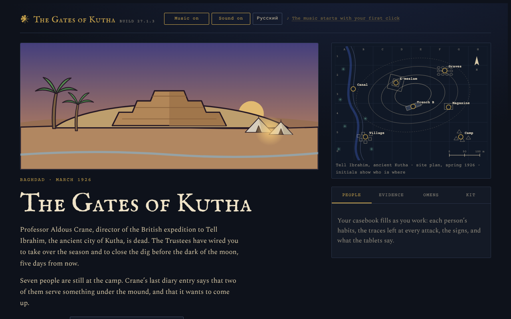
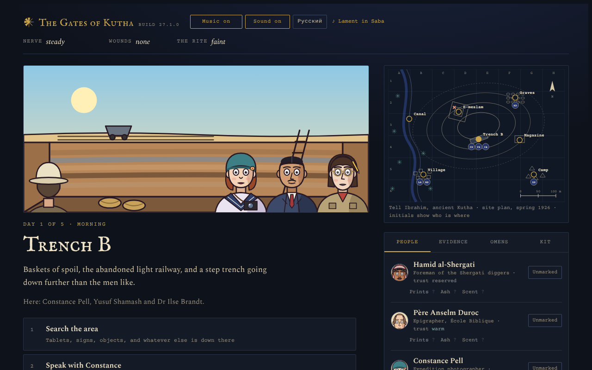
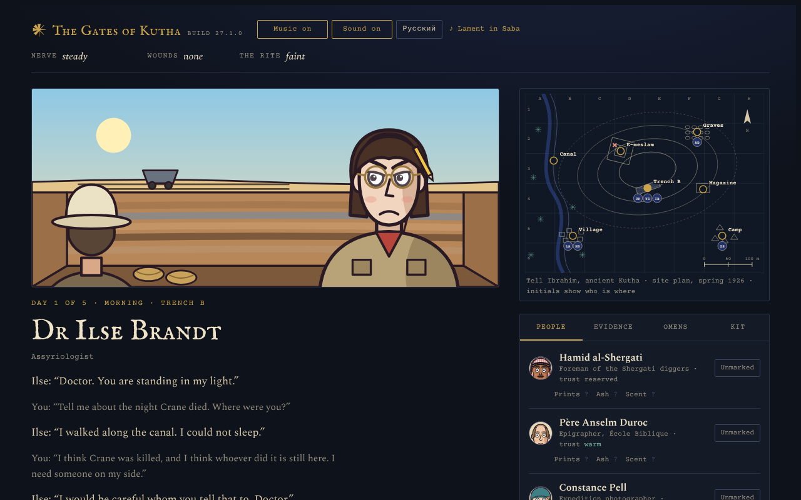
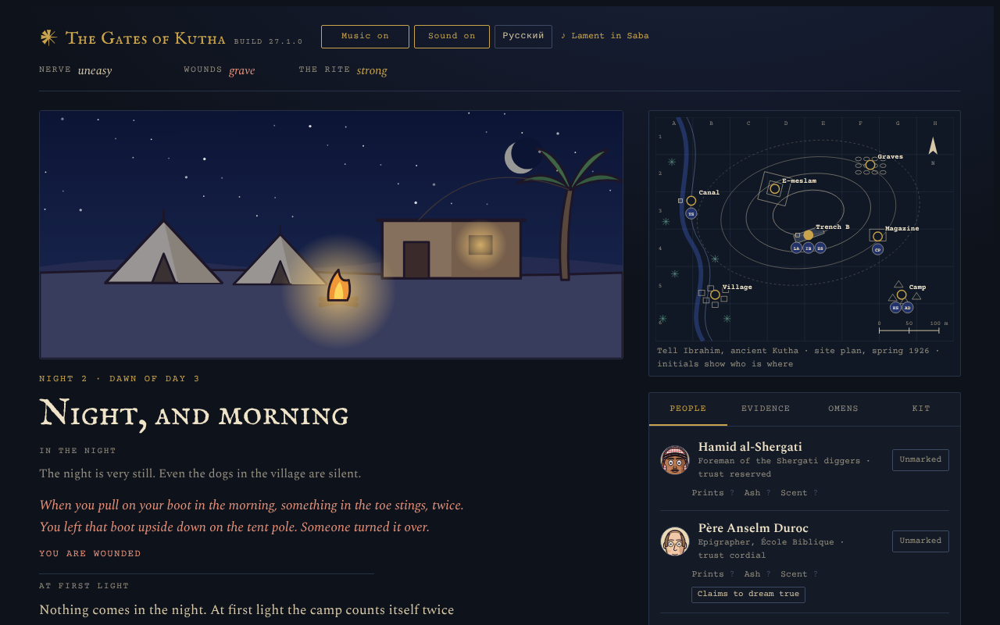
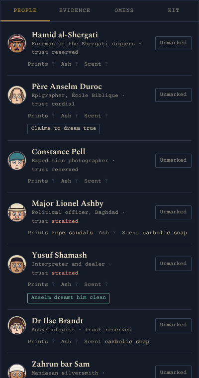
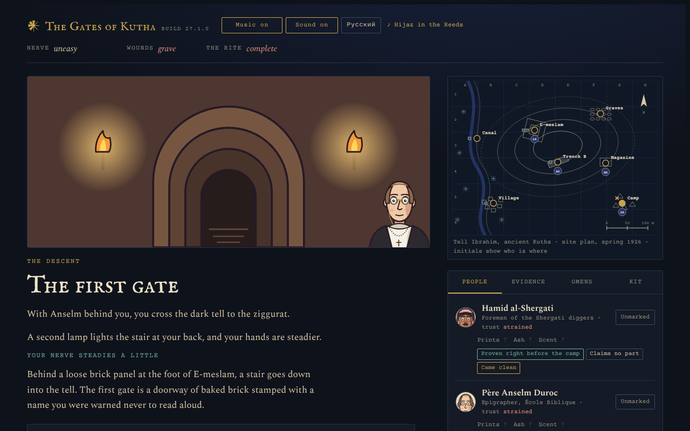
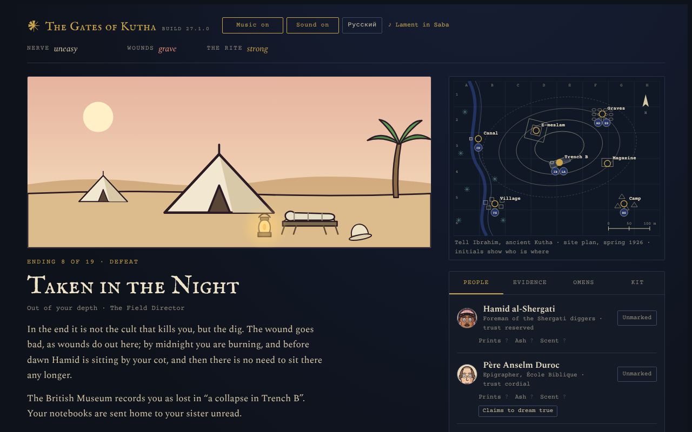
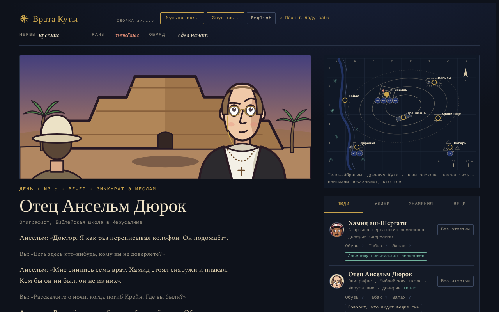

  

<h1 align="center">The Gates of Kutha</h1>

<i>Iraq, March 1926. Seven people are still at the dig. Two of them serve something under the mound.</i>

  <a href="https://ilia-r-s.github.io/the-gates-of-kutha/"><b>Play it in your browser</b></a> ·
  <a href="https://github.com/ilia-r-s/the-gates-of-kutha/releases/latest/download/the-gates-of-kutha.html">Download the game</a> ·
  <a href="docs/rulebook.md">The rulebook</a> ·
  <a href="CHANGELOG.md">What's new</a>

Professor Aldous Crane, director of the British expedition to Tell Ibrahim, the ancient city of Kutha, is dead. The
Trustees have wired you to take over the season and close the dig before the dark of the moon, five days from now.
Crane's last diary entry says that two of the seven people still at the camp serve something under the mound, and that
it wants to come up.

_The Gates of Kutha_ is a Lovecraftian hidden-role mystery for one player, in a single web page: a game of Mafia played
against seven people, each with a temperament of their own, a history with the others, and a story they would rather
tell. Find the two who serve the thing below. Learn from broken tablets which power it is and what binds it. Stop the
rite, before the camp turns on you, the night takes you or your nerve gives out.

## What you do

- **Talk.** Ask where they were last night, whom they distrust, what part they claim in Crane's diary; confide, or
  press. Everyone lies in their own way: the honest hardly ever, the calculating when it pays, the light-headed to be
  liked. A feeling shows in a face, a greeting or a parting look, when it shows at all.
- **Investigate.** Search the trench, the canal, the graves and the finds magazine; read the ground where the night
  struck; set traces against habits in your casebook.
- **Read the tablets.** Fragments in cuneiform give old titles and signs, and somewhere among them a scribe's error.
  Work out which power waits below, and which charm binds it.
- **Accuse.** At an evening inquiry, make your case before the camp. They raise their hands, or they don't, and they
  remember either way.
- **Live through the nights.** The night takes people. The camp grieves, gossips and blames, and now and then someone
  comes to your tent.
- **Go down.** On the last night, or sooner if the rite runs ahead of you, the gate opens. Choose who comes with you,
  pass the seven gates, and face what waits in the sanctum.

## Why it plays differently

- **Nothing is certain.** Every answer and every outcome is a throw of the dice. No single tell gives the cult away:
  you find it by reasoning over many things.
- **No numbers on the screen.** Your nerve, your wounds and the rite are told in words, and the game never shows a
  probability.
- **People, not tokens.** Seven temperaments, likes and grudges, gossip true and false, and a camp that moves together
  when something happens before everyone.
- **Every season is new, and any season can come again.** Parts, powers, tablets and the season's mood are dealt
  afresh, and every season has a code: put it in the game's address to play that season again, or hand it to a friend.
- **Nineteen endings,** each with its own picture, and an epilogue for everyone who was there.
- **English and Russian,** switched at any moment.
- **One page, drawn and scored in code.** Every picture is drawn as SVG and the music is synthesised as it plays. No
  installation, no account, nothing sent anywhere.

## Pictures

<table>
  <tr>
    <td width="50%"> A morning at Trench B. Initials on the site plan show who is where.</td>
    <td width="50%"> A conversation. Two questions, then you take your leave.</td>
  </tr>
  <tr>
    <td width="50%"> Night, and morning: what the dark brought, and what the camp makes of it.</td>
    <td width="50%"> Where to go next, and the casebook: habits, trust, claims and your marks.</td>
  </tr>
  <tr>
    <td width="50%"> Below: the first of seven gates.</td>
    <td width="50%"> One of nineteen endings.</td>
  </tr>
  <tr>
    <td colspan="2"> The whole game in Russian, too.</td>
  </tr>
</table>

## Playing

- **[Play it here](https://ilia-r-s.github.io/the-gates-of-kutha/),** or download the game as one HTML file from the
  [latest release](https://github.com/ilia-r-s/the-gates-of-kutha/releases/latest) and open it in any current browser.
  It plays offline too; only the typefaces come from the web, and without them the browser's own stand in.
- **Sound:** browsers keep it back until you click or tap, so the music starts with your first choice.
- **It is hard.** Bots that play like careful people lose nine seasons in ten, and a clean victory comes about once in
  forty. Read the casebook well and you will do better.
- **Season codes:** every season's code is on the ending page. Add it to the address
  (`https://ilia-r-s.github.io/the-gates-of-kutha/?seed=1A2B-3C4D`), and the same season is dealt again; _Play this
  season again_, at the end, needs no code at all.
- **Your casebook, your way:** your reply to the Trustees decides how the casebook is kept for the season, joining up
  what you learn for you, or keeping only the bare record (hardcore).
- **Browsers:** Chrome or Edge 80+, Firefox 72+, Safari 13.1+, on screens from phones (360 pixels wide) up. The details
  are in [REQUIREMENTS.md](REQUIREMENTS.md).

## Learn more

- [The complete rulebook](docs/rulebook.md): every rule, every probability, and how often each ending comes. Spoilers,
  of course.
- [RULES.md](RULES.md): the same rules as the code names them, for whoever tunes the game.
- [CHANGELOG.md](CHANGELOG.md): what each build changed.
- [DEVELOPING.md](DEVELOPING.md): building it, testing it, and how the code is laid out; [CLAUDE.md](CLAUDE.md): the
  project's standing rules.

## Credits

Made by ilia-r-s. The code, the pictures, the music, and the text in English and Russian were written with Claude, by
Anthropic.
