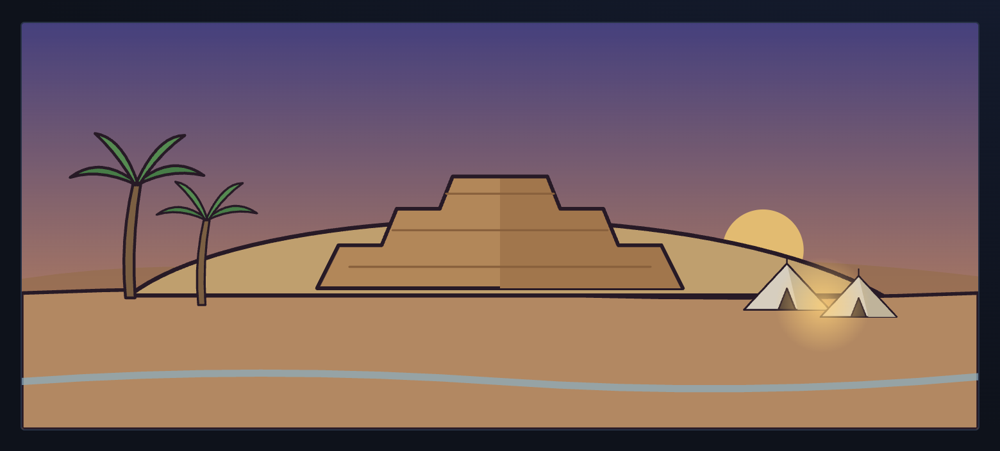
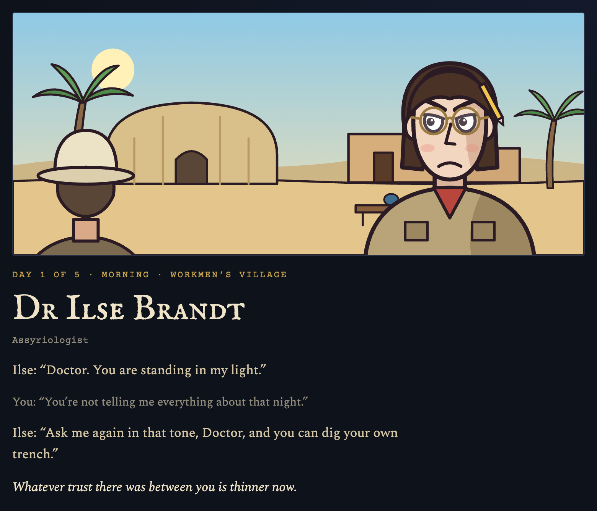
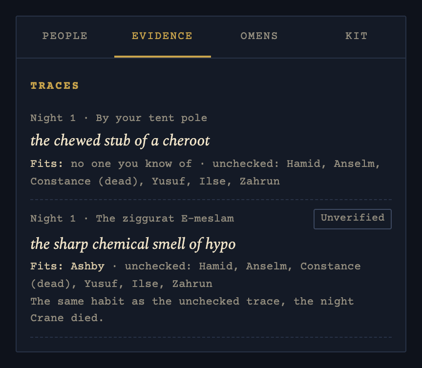
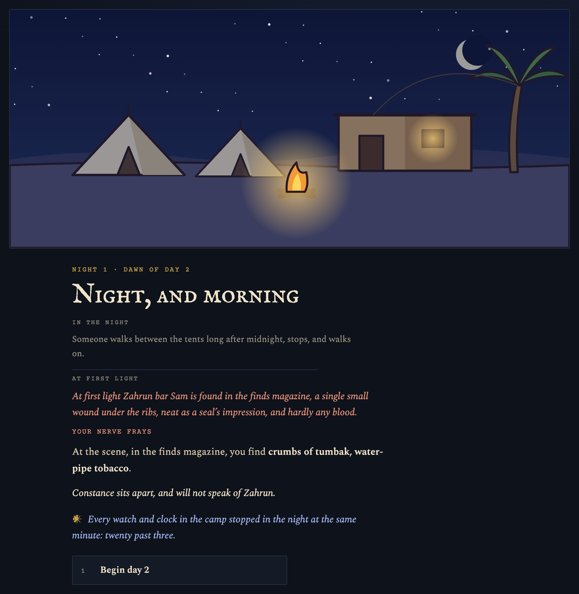
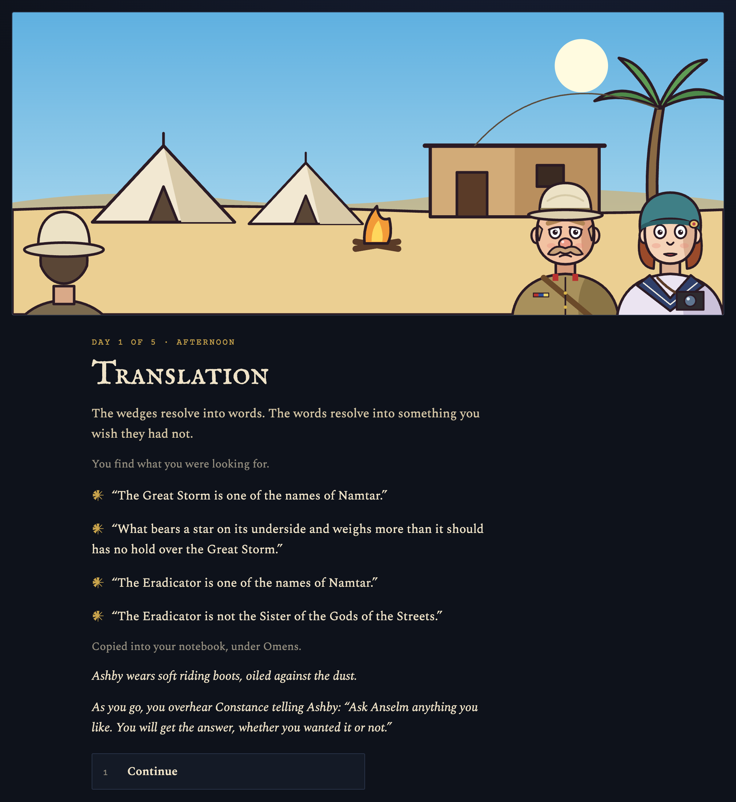
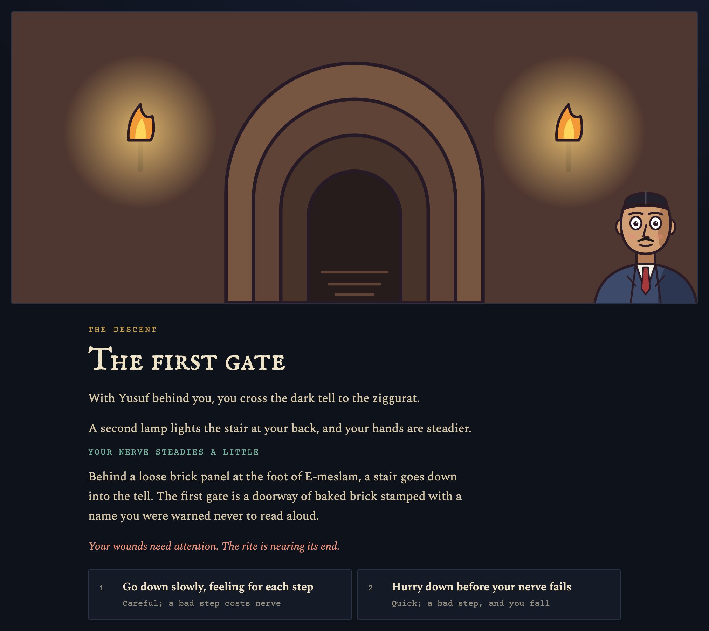

<h1 align="center">The Gates of Kutha</h1>

<a href="https://ilia-r-s.github.io/the-gates-of-kutha/">Play in your browser</a>

<i>Tell Ibrahim, Iraq. March 1926.</i>

  

Professor Aldous Crane is dead. You have his desk, his unfinished excavation, and five days to close the dig.

There are seven people left in camp. They have worked together, quarrelled, kept each other's secrets. You have
Crane's diary.

> Two of them hear it. One of them dreams true, and one keeps watch, God bless them both. One is a thief, but only
> a thief. The rest are what they seem. I cannot tell which is which, and the rite will be finished at the dark
> of the moon.

Something under the mound is listening, too.

_The Gates of Kutha_ is a choice-driven mystery about an archaeological expedition, the people in it, and the things
an excavation brings to light. The rite is already under way. Its servants need time, and your attention elsewhere.

---

### By daylight

Choose the training you brought to Iraq: philologist, former soldier, or occultist. Then spend the daylight you have.
Excavate, translate the broken tablets, search the camp, or sit down with somebody who was awake last night.
Each takes time. The work you leave undone waits for tomorrow, if there is a tomorrow.

You can ask a question gently. You can ask it again. You can put your trust in somebody who seems to need it.
What you say may reach the rest of camp before you do.

  

Professional courtesy has its limits.

Open your casebook when you need the map, the evidence, or a reminder of who said what. Compare traces, habits and
accounts of the night. Make your own marks against the names. Then put the book away and ask another question.
A witness may be mistaken; a liar may be hiding an ordinary shame. Even the thief has something to fear.

  

When you think you have a case, call an inquiry. Ask the camp to judge it with you. An accusation can take somebody
out of the night's reach—or leave you with fewer friends when the lamps go out.

### After dark

Someone has promised to keep watch. Someone dreams. In the morning there will be a story about the night. Perhaps
several. Footprints, a familiar scent, a little ash where it should not be. The dead do not get to correct anybody's
account.

  

The seven have lives between your questions. Affection, suspicion, grief and gossip travel through camp. People
remember how you treated them, and what you said about somebody else. A trusted companion might keep you alive.

### Under all of it

The old titles disagree. So do the people who read them for you. Fit together the signs and the broken clay:
what waits below has a name, and somewhere in the camp is the charm that might hold it there.
There are hints of what it favors, too. A patient hand, an offering, a word spoken plainly. A sign can be misread.

  

When the gates open, choose who goes down with you. Bring what you have learned, what you have found, and whatever
nerve you have left. The seven gates ask their price.

  

The roles, traces and fragments change with each expedition. At the end, the reckoning opens the case: what
happened, who survived, and what your choices cost.

---

A game by [Ilia R.S.](https://github.com/ilia-r-s).

At the worktable

[Building and testing](DEVELOPING.md) · [Research notebooks](docs/research/README.md) · [Changelog](CHANGELOG.md)

